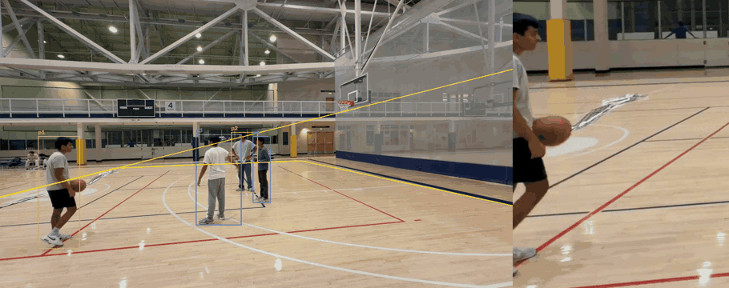

# courtcam

One fixed wide shot of a court goes in. Per-player tracks in metres on the court, a smooth
follow-cam crop path for every player, and events and plays come out. Everything
sport-specific lives in a sport profile (a YAML file plus a court template), so the core
code never branches on the sport. Profiles included: basketball (half and full court),
pickleball, badminton and volleyball.



Debug overlay (court polygon, boxes, player ids) on the left, the follow-cam rendition for
one player on the right, on a real 2v2 pickup game filmed with one phone.

## What you get

- Every player's position in metres on the court, with a stable player id and a team.
- A follow-cam rectangle per player per frame (a few KB of JSON, not a rendered video),
  plus an optional baked MP4 per player.
- Events (shots, possessions, rallies, blocks, hype moments) and whole plays built from
  them, from per-sport rules in the profile.
- "Replay, clip that" triggers from a voice command or an X gesture, resolved to the play
  they refer to.

## How it works

The pipeline runs these stages in order (`courtcam/pipeline.py`). Each stage is a
file-to-file function that skips itself when its output is already on disk, so an
interrupted run resumes instead of restarting.

| Stage       | What it does                                                                                 |
| ----------- | -------------------------------------------------------------------------------------------- |
| `ingest`    | Probes the source, writes a 30 fps H.264 mezzanine and still frames.                         |
| `calibrate` | Landmark clicks plus the court template give a homography (pixels to metres).                |
| `detect`    | Person detection and tracker association (BoT-SORT) in one pass.                             |
| `track`     | Groups per-frame detections into tracklets.                                                  |
| `court`     | Projects each foot point onto the court and keeps only tracklets that live inside the lines. |
| `identity`  | Splits teams and merges tracklets into stable player ids `p1..pN`.                           |
| `tracks`    | Writes court positions in metres as 10 s chunks.                                             |
| `crops`     | Fits a critically damped follow-cam crop path per player.                                    |
| `audio`     | Extracts 16 kHz mono audio, keeps the source audio, finds onsets and hype spikes.            |
| `pose`      | 2D keypoints on a crop around each tracked player.                                           |
| `events`    | Runs the event detectors named in the profile's `events:` list.                              |
| `triggers`  | Finds X gestures in the poses and "Replay, clip that" voice commands.                        |
| `plays`     | Builds whole plays from events with the profile's play grammar, and cuts clips.              |

Details worth knowing:

- **Calibration.** Four or more clicked landmarks (or `landmarks_optional` points such as
  key corners) give the homography. `courtcam autocalib` proposes the landmarks for you by
  fitting the court template to the painted lines, or by asking a vision model
  (`--backend vlm`). An optional one-parameter lens model handles barrel distortion.
- **Detection backends.** `--detector synthetic` reads ground-truth boxes and needs no
  weights. `--detector yolo` runs YOLO11 through the `yolo` extra. A detector is any
  callable that yields `FrameDets`, so you can plug in your own (see `courtcam/detect.py`).
- **Court mapping.** A homography, not a 3D reconstruction: one camera, one flat court.
  The on-court filter is what separates players from the bench and spectators.
- **Identity.** Teams come from the profile's `team_rule`: `jersey_color` (k-means over
  torso colour) or `net_side` (which side of the net a player's median position falls on).
  Tracklets are merged within a time and distance window.
- **Crops.** The `followcam` block of the profile sets zoom, lead and stiffness. Zoom
  divides the court's pixel width, so the same number frames the same way on any source.
- **Pose.** `--pose yolo` or `--pose vit` (ViTPose) from the Python API; keypoints feed the
  X gesture and the events that need them.
- **Triggers.** Voice: Whisper ASR, then a fuzzy match of "Replay, clip that" (or a
  player's name) against the roster. Gesture: forearms crossed in an X, held briefly. A
  trigger resolves to the play that most recently ended before it, and the clip is that
  whole play.
- **Plays.** A grammar is data in the profile: a state machine (for example possession
  change to shot or turnover, or serve to point) or a sequence (pass, set, attack).

## Install

Python 3.12. `ffmpeg` and `ffprobe` must be on `PATH`.

```sh
pip install -e .              # core
pip install -e ".[dev]"       # + pytest, ruff
# or with uv
uv sync
```

| extra     | adds                                              | for                                                                                                                     |
| --------- | ------------------------------------------------- | ----------------------------------------------------------------------------------------------------------------------- |
| _(none)_  | OpenCV, NumPy, pydantic, typer, PyYAML, tqdm, lap | `synth`, calibration, `--detector synthetic`, tracks, identity, court, crops, events, plays, overlays, renders, metrics |
| `dev`     | pytest, ruff                                      | the test suite and linting                                                                                              |
| `yolo`    | ultralytics, torch, torchvision                   | `--detector yolo` (the CLI default) and `--pose yolo`                                                                   |
| `vitpose` | transformers, torch                               | `--pose vit` (ViTPose)                                                                                                  |
| `asr`     | transformers, torch                               | voice triggers (Whisper)                                                                                                |
| `vlm`     | anthropic                                         | `autocalib --backend vlm`                                                                                               |

Asking for a backend whose extra is not installed fails at once with an `ImportError` that
names the extra, for example `pip install 'courtcam[yolo]'`.

## Quickstart

Paths are relative to the repository root, where `samples/` lives.

```sh
# run the whole pipeline on the synthetic fixture; no model weights needed
courtcam run --detector synthetic \
    --input samples/synthetic/basketball_half/clip.mp4 \
    --calib samples/synthetic/basketball_half/landmarks.json \
    --sport basketball --variant half \
    --out out/

# only re-run some stages (this also forces them to recompute)
courtcam run --detector synthetic --input samples/synthetic/basketball_half/clip.mp4 \
    --out out/ --stages detect,track,court

# check it with your eyes: court polygon, boxes and ids burned into an MP4
courtcam overlay --out out/

# bake one player's follow-cam into an MP4 (media/p1.mp4)
courtcam render --out out/ --player p1

# generate a synthetic clip with ground truth and landmark clicks
courtcam synth --out /tmp/basketball_half --sport basketball --variant half

# calibration from landmark clicks, and a proposal from a still frame
courtcam calibrate --landmarks samples/synthetic/basketball_half/landmarks.json --out out/calib.json
courtcam autocalib --frame out/media/calib.jpg --out landmarks.json

# list the installed sport profiles
courtcam sports
```

With the `yolo` extra installed, drop `--detector synthetic` to detect people in a real
video. When `--calib` and `--ground-truth` are omitted, `run` looks for `landmarks.json`
and `ground_truth.json` next to the input.

Useful flags on `run`: `--stride` (detect every Nth frame), `--max-frames`, `--title`,
`--ground-truth`, `--landmarks` (a path or inline JSON), `--backend {pt,openvino,onnx}`,
`--model <weights>`. `--landmarks` and `--calib` accept a `landmarks.json`
(`{"variant": "half", "landmarks_px": {...}}`), a bare `{"corner_nl": [x, y], ...}` object,
or an already computed `calib.json`.

Other commands: `eval` (MOTA, IDF1 and ID switches against synthetic ground truth),
`eval-events` (detected shots and highlights against a hand-annotated play log), `notes`
(store play descriptions as `notes.json`) and `autocalib-eval`.

## Using it from Python

```python
from pathlib import Path
from courtcam import pipeline

def on_progress(stage: str, fraction: float) -> None:
    print(f"{stage} {fraction:.0%}")

game_json = pipeline.run(
    Path("game.mp4"), Path("out/"),
    sport="basketball", variant="half",
    landmarks_px={"corner_nl": (120, 810), ...},   # or calib=Path("landmarks.json")
    detector="yolo",                                # or "synthetic" + ground_truth=
    progress=on_progress,
    show_progress=False,
)
```

`pipeline.run` returns the path to `out/game.json`. Every stage is also importable on its
own (`pipeline.stage_detect`, `stage_crops`, and so on).

## Output format

Files written to the output directory:

```
out/
  game.json              replay.game.v1   the index; `stages` fills in as they finish
  calib.json             homography, its inverse, court polygon in px and metres
  media/wide.mp4         30 fps H.264 faststart mezzanine at source resolution
  media/thumb.jpg  media/calib.jpg
  tracks/00000.json ...  replay.tracks.v1 - 10 s chunks at 10 Hz, positions in metres
  crops/p1.json ...      replay.crops.v1  - one rect per video frame at 30 Hz, t0 = 0
  audio/                 16 kHz mono WAV and the source audio; audio.json holds the signals
  poses/00000.json ...   2D keypoints per tracked player
  events.json            replay.events.v1
  triggers.json          voice and gesture triggers
  plays.json             whole plays built from events
  clips.json             clips cut from plays and triggers
  media/<player>.mp4     only after `courtcam render`
  _work/                 intermediates (dets, tracklets, court tracks, players)
```

`_work/` is what makes stages resumable. Delete a file in it to force that stage to
recompute, or delete the directory to start over from the mezzanine.

## Sport profiles

A profile is `courtcam/sports/<id>.yaml` plus one court template JSON per variant. Core
code reads only the profile's fields.

| profile      | variants                                       | team rule      | events                           |
| ------------ | ---------------------------------------------- | -------------- | -------------------------------- |
| `basketball` | half, full (FIBA, NBA, NCAA and NFHS markings) | `jersey_color` | shot, possession, lost_man, hype |
| `pickleball` | doubles                                        | `net_side`     | rally, hype                      |
| `badminton`  | doubles                                        | `net_side`     | rally, hype                      |
| `volleyball` | indoor                                         | `net_side`     | rally, block, hype               |

```yaml
id: basketball
display_name: Basketball
tier: 2
court:
  templates: { half: basketball_half.json, full: basketball_full.json }
  variants: [half, full]
  landmarks: [corner_nl, corner_nr, corner_fl, corner_fr, rim]
  landmarks_optional: [key_nl, ...] # folded into the fit if present
  margin_m: 1.0 # how far off the lines a player may stray
players: { min: 2, max: 10 }
team_rule: jersey_color # or net_side
detection:
  { classes: [person], stride: 2, model: yolo11n.pt, imgsz: 960, conf: 0.25 }
tracking:
  { oncourt_min_fraction: 0.6, min_lifetime_s: 1.0, merge_max_gap_s: 5.0, ... }
events: [shot, possession, lost_man, hype] # which detectors run
followcam: { zoom: 2.4, lead_s: 0.3, stiffness: 7.0 }
```

A court template is metres in the profile's origin convention, with `+x` toward the right
sideline and `+y` into the court. It carries the court polygon (the on-court filter tests
against it), named landmarks (what a user clicks) and `features`, polylines used for
drawing.

### Adding a sport

1. Write `courtcam/sports/<sport>.json`: the court polygon and line polylines in metres,
   plus `landmarks` for the points a user will click.
2. Write `courtcam/sports/<sport>.yaml` with the fields above.
3. Check it: `courtcam synth --out /tmp/<sport> --sport <sport>` renders the template
   through a virtual camera, then run the pipeline on it with `--detector synthetic`.
4. If the sport needs a new event type, add a detector function to `events.DETECTORS`.

## Tests

```sh
pytest -q
```

225 tests pass, and none needs model weights. The synthetic fixtures live under
`samples/synthetic/`. The suite runs the whole pipeline over them with
`--detector synthetic`, validates every output against the schemas, and compares against
golden files with tolerances. Regenerate the fixtures and goldens with:

```sh
python samples/synthetic/generate.py --goldens
```

## Used by

[Replay](https://github.com/subatomic-hamster/replay), the Fire TV app that turns courtcam's
outputs into Follow a player, highlights and replay angles. Heavy processing there runs on
Amazon EC2 GPU instances.

## License

MIT, see `LICENSE`. courtcam's own code is MIT and its required dependencies are
permissive. The optional extras pull in third-party packages under their own licences:

- `yolo` installs ultralytics (AGPL-3.0, code and YOLO11 weights). It is imported only when
  a YOLO path is requested. `--detector synthetic` or your own `Detector` do not use it.
- `vitpose` uses ViTPose weights (Apache-2.0) through transformers.
- `asr` uses Whisper through transformers.
